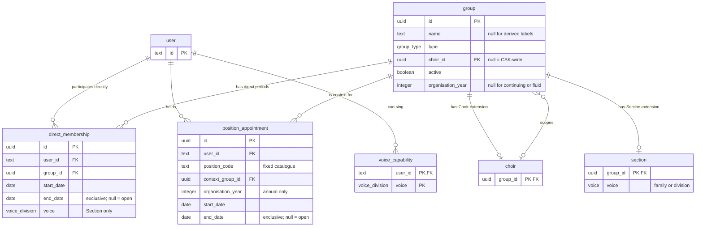

# Groups database schema

This document describes the organisation model after the Positions and Groups redesign:
concrete Groups, independent direct Memberships, and single Position appointments that can
grant Membership in several Groups. It replaces the earlier v2/v3 schemes with one current
reference, including the Voice model and worked examples.

The implementation sources are:

- [Organisation tables](../../src/core/db/schema/org-structure.ts) and
  [Voice tables and types](../../src/core/db/schema/voice.ts).
- [Core organisation definitions](../../src/core/org-structure/README.md) and the
  [fixed Group and Position catalogues](../../src/core/org-structure/catalogue.ts).
- [Organisation module guide](../../src/features/org-structure-management/README.md) for public commands
  and reads, and [the glossary](../../GLOSSARY.md#groups) for shared domain language.
- [Expansion migration](../../drizzle/0017_expand-organisation-appointments.sql) and
  [final cutover migration](../../drizzle/0018_retire-legacy-organisation-model.sql) for
  hand-written constraints and triggers that Drizzle cannot represent.
- [Derived-membership migration](../../drizzle/0020_derive-appointment-memberships.sql), which
  removes stored grant connections while retaining appointments and direct Memberships.

Identifiers below use actual PostgreSQL names. User IDs are `text`; Group, direct Membership,
and appointment IDs are UUIDs. Choir and Section extensions reuse their Group's UUID.
Dates are PostgreSQL `date` values, without a time of day.

## Terminology

| Term | Meaning | Representation |
| --- | --- | --- |
| Group | A concrete set of participants, either CSK-wide or belonging to one Choir. | `group` |
| Choir | MK, DK, or KK; itself a CSK-wide Group. | `group` + `choir` extension |
| Section | The people in a Choir singing one Voice, such as KKB or MKB1. | `group` + `section` extension |
| Voice family | S, A, T, or B. A musical line, never a Group. | `voice_family` domain |
| Voice division | S1, S2, A1, A2, T1, T2, B1, or B2. | `voice_division` domain |
| Voice | A family or division. A Section can sing either; a singer's placement uses a division. | `voice` enum |
| Organisational year | 1 July through 30 June; 26/27 starts in 2026. | `organisation_year = 2026` |
| Direct Membership | An independently assigned period of participation, including singer placement and Helpers. | `direct_membership` |
| Position | A recognised organisational responsibility, Swedish *post*, with fixed rules. | Stable code in the code catalogue |
| Appointment | One person's tenure in a Position and concrete context. | `position_appointment` |
| Context | The Group that identifies which responsibility is held: a particular Board, Choir, Section, or gig group. | `context_group_id` |
| Grant | Membership implied by the Position catalogue, context, and year for the appointment's tenure. | Derived by reads; no stored connection |
| Effective Membership | Participation from direct Memberships and appointment grants, evaluated at a date. | Computed by public reads; no separate table |
| Helper | A direct member of a Helper-enabled committee without an appointment granting participation there. | `direct_membership`; no invented Position |
| News Post | An item in the news feed; separate from an organisational Position. | News model, outside this schema |

A Position does not confer application authorization privileges through this redesign.
Standing order or formation, if later modelled, should use Placement or Formation rather
than Position. A Part in a musical arrangement is a repertoire concept, outside this model.

## Group identity, scope, and lifetime

A Group is CSK-wide when `choir_id IS NULL`, or belongs directly to one Choir otherwise.
There is no deeper hierarchy. A Choir itself is CSK-wide; its Sections and choir teams
reference its `choir.group_id`. A gig group is CSK-wide and may contain singers from
several Choirs.

Annual Groups have separate UUIDs for each year. Their localized display labels are derived
from `type` and `organisation_year`, which identify the annual organisation. There is no continuing
parent Board above Board 26/27 and Board 27/28.

| Stored Group type | Scope | Lifetime | Direct Membership | Cardinality |
| --- | --- | --- | --- | --- |
| `Choir` | CSK-wide | Continuing | Yes | Existing MK, DK, KK |
| `Section` | One Choir | Continuing | Singer placement | Four non-overlapping Sections per Choir |
| `Board` | CSK-wide | Annual | No | One per year |
| `Gigmästeri` | CSK-wide | Annual | Helpers | One per year |
| `Sexmästeri` | CSK-wide | Annual | Helpers | One per year |
| `Konsertmästeri` | CSK-wide | Annual | Helpers | One per year |
| `Rekryteringskommitté` | CSK-wide | Annual | Helpers | One per year |
| `Turnékommitté` | CSK-wide | Annual | Helpers | One per year; only one operates at a time |
| `Valberedning` | CSK-wide | Annual | Yes; no Positions | One per year |
| `Webmästeri` | CSK-wide | Annual | Yes; no Positions | One per year |
| `Arkivarie` | CSK-wide | Annual | Yes; no Positions | One per year |
| `Utantillkommitté` | CSK-wide | Annual | Yes; no Positions | One per year |
| `Föräldramötet` | CSK-wide | Continuing | No | One continuing identity |
| `Roddgrupp` | One Choir | Fluid | Yes; no Positions | At most one active per Choir |
| `Festgrupp` | One Choir | Fluid | Yes; no Positions | At most one active per Choir |
| `Rephelg` | One Choir | Fluid | Yes; no Positions | At most one active per Choir |
| `GigGroup` | CSK-wide | Fluid | Yes | Multiple |
| `Övrig` | CSK-wide | Fluid | Yes; no Positions | Multiple |

These are the values of the native PostgreSQL `group_type` enum, defined from the core
`GroupType` string enum in [`identifiers.ts`](../../src/core/org-structure/identifiers.ts).
Use named identifiers such as `GroupType.Board` in application code. `Arkivarie` is the retained
storage identifier for Arkivariet. `Övrig` is a compatibility type for explicit participation,
not a way to bypass the rules of a known formal Group type.

Annual types require a year; continuing and fluid types forbid it. Continuing identities
such as Choirs and Föräldramötet persist across July. Fluid teams and appointments have no
automatic June deadline. Preparing a year creates the required annual Groups, reusing existing
identities; it never copies people or renews appointments.

### Concrete structure examples

| Group | Type | `choir_id` | `organisation_year` | `section.voice` |
| --- | --- | --- | --- | --- |
| MK / DK / KK | `Choir` | null | null | — |
| MKT1 / MKT2 / MKB1 / MKB2 | `Section` | MK | null | T1 / T2 / B1 / B2 |
| DKS1 / DKS2 / DKA1 / DKA2 | `Section` | DK | null | S1 / S2 / A1 / A2 |
| KKS / KKA / KKT / KKB | `Section` | KK | null | S / A / T / B |
| Styret 26/27 | `Board` | null | 2026 | — |
| Styret 27/28 | `Board` | null | 2027 | — |
| Konsertmästeriet 26/27 | `Konsertmästeri` | null | 2026 | — |
| Föräldramötet | `Föräldramötet` | null | null | — |
| MK roddgrupp | `Roddgrupp` | MK | null | — |
| A particular gig ensemble | `GigGroup` | null | null | — |


### Stored names and localized labels

| Category | Stored `name` | Display label |
| --- | --- | --- |
| Annual Groups | Null | Localized Group type + organisational year |
| Choir teams | Null | Owning Choir's explicit name + localized team type |
| Parents meeting | Null | Localized Group type |
| Choirs and Sections | Required nonblank name | Their explicit identity, such as MK or KKB |
| Gig groups and Other Groups | Required nonblank name | Their editable individual name |

`group-names.ts` defines `EXPLICIT_GROUP_NAME_TYPES` with enum values. Both application
validation and the schema check use this list. Renaming a derived-label Group is refused;
Group creation and edits store null for those types even if an old caller supplies a name.
Derived names are not copied into storage or used as identity. Renaming a Choir changes its
teams' displayed labels immediately, without updating team rows.

The English enum member names (for example `GroupType.ConcertCommittee` and
`PositionCode.FirstConcertMaster`) are independent of the retained storage strings.
`groupTypeKey` and `positionCodeKey` provide English intl keys. All display text lives in
the English, Swedish, and German message catalogues, not in `POSITION_DEFINITIONS`.
`formatGroupLabel` uses ICU templates for annual and Choir-team labels so each locale owns
word order. Domain reads return identities and nullable explicit names; presentation reads
resolve localized labels for group lists, details, assignment context choices, and profiles.

## Tables and keys

The following is a schema reference, not executable migration SQL. UUID primary keys default
to `gen_random_uuid()`. All references restrict Group deletion; User references cascade.

```text
group (
  id uuid PRIMARY KEY,
  name text NULL,
  type group_type NOT NULL,
  choir_id uuid NULL REFERENCES choir(group_id) ON DELETE RESTRICT,
  active boolean NOT NULL DEFAULT true,
  organisation_year integer NULL
)

choir (
  group_id uuid PRIMARY KEY REFERENCES group(id) ON DELETE RESTRICT
)

section (
  group_id uuid PRIMARY KEY REFERENCES group(id) ON DELETE RESTRICT,
  voice voice NOT NULL
)

direct_membership (
  id uuid PRIMARY KEY,
  user_id text NOT NULL REFERENCES user(id) ON DELETE CASCADE,
  group_id uuid NOT NULL REFERENCES group(id) ON DELETE RESTRICT,
  start_date date NOT NULL,
  end_date date NULL,
  voice voice_division NULL
)

position_appointment (
  id uuid PRIMARY KEY,
  user_id text NOT NULL REFERENCES user(id) ON DELETE CASCADE,
  position_code text NOT NULL,
  context_group_id uuid NOT NULL REFERENCES group(id) ON DELETE RESTRICT,
  organisation_year integer NULL,
  start_date date NOT NULL,
  end_date date NULL
)

voice_capability (
  user_id text NOT NULL REFERENCES user(id) ON DELETE CASCADE,
  voice voice_division NOT NULL,
  PRIMARY KEY (user_id, voice)
)
```

### What each participation record owns

A direct Membership owns its person, Group, period, and optional singer Voice. Its UUID stays
stable when an Admin corrects an erroneous record. An ordinary change instead closes the old
period and opens a successor, preserving history.

An appointment owns its person, Position, context, year where applicable, and tenure.
`position_code` is text validated against the fixed catalogue by a trigger, not a foreign key
to an editable Position table. Labels are translated separately from stable codes.

Grants have no stored records. The shared appointment-membership query derives each target
from `POSITION_DEFINITIONS`, the appointment's context, and its explicit organisational year:

- A grant of the context's type targets that exact context UUID.
- Other annual targets match the required type and the appointment's year.
- The continuing Föräldramötet target uses its unique continuing identity.
- Positions with an empty grant list add no Membership; their prerequisite remains independent.

Archived targets remain included for historical reads. The same catalogue applies to current,
future, and historical appointments; policy changes deliberately reinterpret all years. There
are no policy snapshots or versions. Creation and correction still validate that every required
concrete target exists and is available, and perform any Helper conversion atomically.

The context does not automatically grant Membership. For a Board Position it is a granted
Group; for a choir responsibility it is an eligibility prerequisite. These meanings are
explicitly defined by the catalogue.

## Fixed Position catalogue

The core `PositionCode` enum defines stable identifiers separately from their definitions.
Catalogue entries use computed keys such as `[PositionCode.Sekreterare]`, with
`context: GroupType.Board` and `grants: [GroupType.Board, GroupType.ParentsMeeting]`.
Both catalogues are exhaustive typed records over their respective identifier enums.

For every annual grant below, “year's” means the appointment's explicit Organisational year.
Board contexts already carry that year; annual choir appointments store it separately because
their Choir context continues across years.

| Stable `position_code` | Label | Context type | Required direct Membership | Granted Membership | End policy |
| --- | --- | --- | --- | --- | --- |
| `ordforande` | Ordförande | Board | None | Context Board | Annual |
| `vice-ordforande` | Vice Ordförande | Board | None | Context Board + year's Rekryteringskommitté | Annual |
| `kassor` | Kassör | Board | None | Context Board | Annual |
| `sekreterare` | Sekreterare | Board | None | Context Board + continuing Föräldramötet | Annual |
| `pr-mastare` | PR-mästare | Board | None | Context Board | Annual |
| `forsta-konsertmastare` | 1:a Konsertmästare | Board | None | Context Board + year's Konsertmästeri | Annual |
| `csk-gigmastare` | CSK Gigmästare | Board | None | Context Board + year's Gigmästeri | Annual |
| `sexmastare` | Sexmästare | Board | None | Context Board + year's Sexmästeri | Annual |
| `sexmastarinna` | Sexmästarinna | Sexmästeri | None | Context Sexmästeri | Annual |
| `ekonomiskt-ansvarig` | Ekonomiskt Ansvarig | Turnékommitté | None | Context Turnékommitté | Annual |
| `dirigent` | Dirigent | Choir | Context Choir | None | Fluid |
| `notfiskal` | Notfiskal | Choir | Context Choir | None | Fluid |
| `choir-konsertmastare` | Choir Konsertmästare | Choir | Context Choir | Year's Konsertmästeri | Annual |
| `choir-gigmastare` | Choir Gigmästare | Choir | Context Choir | Year's Gigmästeri | Annual |
| `stamforalder` | Stämförälder | Section | Context Section | Continuing Föräldramötet | Fluid |
| `gigledare` | Gigledare | GigGroup | Context GigGroup | None | Fluid |

Prerequisites must cover the entire appointment, including prepared future dates. Adjacent
direct Membership periods can together provide continuous coverage. A gap is refused.
CSK-wide appointees need no Choir Membership. A conductor can have a Choir Membership without
a Section placement if they do not sing.

There is one Choir Gigmästare definition with different Choir contexts, rather than a separate
Position definition per Choir. It remains distinct from CSK Gigmästare. Unstaffed Positions
have no appointment row: vacancies do not need placeholder Users or empty holdings.

No runtime Position, applicability, or restriction editor remains. Changes to the catalogue
require a code change and corresponding migration updates where database policy changes.

## Dates, renewal, and history

All direct Memberships and appointments use half-open periods, `[start_date, end_date)`:

```text
active on date D = start_date <= D AND (end_date IS NULL OR D < end_date)
26/27            = [2026-07-01, 2027-07-01)
```

An end date is the first excluded day. Forms display and accept the inclusive last day;
30 June 2027 is stored as `2027-07-01`. Empty and reversed periods are rejected.
A null end is open-ended; it does not make a future record current before its start.

Annual Memberships and appointments must fit within their year and have a finite end. They
may begin late or end early. A September appointment still belongs to Board 26/27 rather
than creating another Board. Annual appointments normally end at the year's exclusive July
boundary. Fluid appointments have a null organisational year and may be open-ended or
explicitly ended, including across July.

Renewal is a new appointment with a new identity for the next year, even for the same holder.
A handover closes the predecessor at boundary D and starts the successor at D: their dates
are adjacent without a gap or overlap. Historical predecessor rows remain available.

## Effective Membership and reads

For a Group and date, effective members are the union of:

1. People whose direct Membership in that Group covers the date.
2. People whose appointment covers the date and whose catalogue definition derives Membership in that Group.

Roster reads deduplicate by person within each Group while retaining every contributing
appointment and its context. Two appointments granting Föräldramötet produce one roster
entry for the person, with both responsibilities visible. A context alone contributes no
Membership, and a Position without grants still appears in appointment reads.

There is no stored effective-membership table or database view. Application consumers use
`@/features/org-structure-management`, including `listEffectiveMembersAt`,
`listEffectiveMembersForGroupsAt`, `listEffectiveParticipationOfUserAt`, and
`listEffectiveGroupsOfUserAt`. Current variants apply the same dated rules using the
organisation's current calendar date. Direct-only management reads are deliberately separate.

Group archival is separate from the participation period. Do not substitute `group.active`
or `end_date IS NULL` for the date predicate. Public reads expose the applicable Group
metadata; active-only choices such as Choir affiliation summaries additionally filter
archived Groups. Profiles and other consumers should use the appropriate public read rather
than reconstructing membership from private tables.

## Invariants and where they are enforced

**DB** means keys, checks, indexes, or exclusion constraints. **Trigger** means hand-written
PostgreSQL policy validation. **App** means coordinated organisation-module commands.
The database checks important local invariants; it is not a complete substitute for commands.

### Groups and structure

| Rule | Enforcement |
| --- | --- |
| Explicitly named types require a nonblank name; all fixed types require null. | DB: `group_name_policy_check`, built from the shared enum-based `EXPLICIT_GROUP_NAME_TYPES` |
| Active non-null names are unique within a Choir or the CSK-wide namespace, including null `choir_id`. | DB: `group_name_choir_active_unique`, hand-written `NULLS NOT DISTINCT` |
| Year is null or an integer from 1000 through 9998. | DB: `group_organisation_year_check` |
| A Choir is CSK-wide; a Section belongs to a Choir. | DB: `group_choir_csk_wide_check`, `group_section_in_choir_check` |
| Fixed catalogue scope applies, and a year exists exactly for annual types. | Trigger: `organisation_group_policy_check` |
| Annual type/year identities are unique, including archived ones. | DB: `group_annual_identity_unique` |
| Föräldramötet has one continuing identity, including archived Groups. | DB: `group_continuing_singleton_unique` |
| At most one active Roddgrupp, Festgrupp, or Rephelg per Choir and type. | DB: `group_choir_team_unique` |
| Choir/Section extensions match their Group types; four Sections per Choir with non-overlapping Voices. | App: Choir creation and structure commands |
| Turnékommitté participation belongs to one committee per year, with no overlap across years. | DB annual identity plus triggers bounding participation to its year |
| Structural edits cannot invalidate existing participation. | App: type/scope/year changes are refused when direct Membership, context appointments, or grants reference the Group, including history |
| Choir and Section reference structure is preserved. | App: ordinary Group editing cannot change their structural identity |

### Direct Membership and singer placement

| Rule | Enforcement |
| --- | --- |
| End is null or strictly later than start. | DB: `direct_membership_period_check` |
| One person's periods in the same Group cannot overlap, including finite historical/future periods. | DB: `direct_membership_overlap_excl` |
| Board and Föräldramötet reject direct Membership. | Trigger: `direct_membership_policy_check` |
| Annual direct Membership fits its Group's year and has a finite end. | Trigger: `direct_membership_annual_check` |
| Voice exists exactly on Section Membership and fits the Section Voice. | Trigger: `direct_membership_voice_check`; domain restricts it to divisions |
| Choir-scoped participation is covered by Choir Membership. | App: dated participation validation |
| A singer has at most one overlapping Section Membership per Choir. | App: dated placement validation under the User lock |
| Multiple Choirs are allowed, each with independent placement and Voice. | App: singer placement commands |
| Taking or leaving a choir/Section/gig responsibility preserves prerequisite Membership. | App: appointment commands |
| Shortening Membership, departing a Choir, or transferring Sections cannot strand an appointment. | App: complete dated dependency validation |
| A Voice change within the same Section preserves Stämförälder when coverage remains continuous. | App: placement and dependency validation |

### Appointments and grants

| Rule | Enforcement |
| --- | --- |
| End is null or strictly later than start; year range is valid. | DB: `position_appointment_period_check`, `position_appointment_year_check` |
| A code is recognised and its context has the catalogue's Group type. | Trigger: `position_appointment_policy_check` |
| Annual appointments have a year, finite end, and dates within that year; context year agrees where present. Fluid appointments have no year. | Trigger: `position_appointment_annual_check` |
| At most one holder per Position/context at any date. | DB: `position_appointment_occupancy_excl` |
| One person holds at most one simultaneous Position on the same Board. | DB: `position_appointment_board_excl`, restricted to Board Position codes |
| Grant type is allowed, annual target year agrees, and a target of the context type is the exact context Group. | App: one shared catalogue-derived membership query, using unique Group identities |
| Every required target Group exists and is available at assignment/correction. | App: catalogue-driven target validation inside the command transaction |
| Prerequisite direct Membership covers the whole tenure. | App: coverage checks on assignment/correction and Membership changes |
| Overlapping Helper participation is converted when the appointment grants that committee. | App: same transaction as the appointment |
| Ending an appointment never restores a Helper Membership. | App: explicit new direct addition required |
| Archival cannot strand current or future appointments using a context or grant Group. | App: archival dependency checks; Choir archival also covers its Sections |

Range exclusions use PostgreSQL `btree_gist` and
`daterange(start_date, end_date, '[)')`. Null ends act as unbounded upper limits. Adjacent
ranges are allowed. These constraints protect historical and future overlap as well as
concurrent attempts to occupy the same Position.

The policy triggers call `organisation_group_policy` and `organisation_position_policy`.
They validate inserted/updated rows, rather than maintaining all dependent rows automatically.
Required target resolution, prerequisite coverage, and dependency revalidation belong to the
application commands. Grant connections are derived by the shared query rather than stored or
validated by a grant-table trigger.

### Atomic writes, corrections, and deletion

Organisation commands run in a transaction, or a nested savepoint when given a transaction.
They use User/appointment/year advisory locks and row locks where appropriate to serialize
conflicting operations. Known constraint errors become typed rule violations such as
`position-taken`, `already-holding-elected-post`, and `period-conflict`. A refused command
rolls back its writes, including appointment changes and Helper conversion.

Appointment corrections retain the appointment UUID, validate the proposed person, code,
context, year, and period, then update the single appointment atomically. Its derived
Memberships immediately reflect that correction. Historical correction and prepared cancellation
are explicit operations. Cancelling a prepared appointment deletes it and removes its derived
Memberships. Ending an existing appointment updates its tenure; earlier dated reads still derive
its historical Memberships from the retained appointment.

When an appointment replaces a Helper period, the prior portion is retained by ending it at
the appointment start. An overlapping Helper row beginning at or after that boundary is
removed. No later Helper period is implicitly restored when the appointment ends.

Groups are archived with `active = false` rather than deleted. A Choir archives its Sections
with it; a Section cannot be archived independently. Group foreign keys use `ON DELETE
RESTRICT` to preserve referenced identities. Deleting a User cascades their direct Memberships,
appointments, and Voice capabilities. Deleting an appointment leaves no stored grant connections.

All application reads and writes of organisation data go through the organisation feature.
Operational seed scripts are the deliberate write exception and validate fixture relationships
before insertion. Admin authorization remains at the application's existing boundary.

## Voice model

Voice is musical; Section is social. Every Choir has four Sections, and a Section sings
exactly one Voice. That Voice may be a family (KKB sings B) or a division (MKB1 sings B1).
Each singer placement records exactly one division contained by that Section's Voice.

```text
VoiceFamily   = S | A | T | B
VoiceDivision = S1 | S2 | A1 | A2 | T1 | T2 | B1 | B2
Voice         = VoiceFamily | VoiceDivision

familyOf(B1)       = B
familyOf(B)        = B
contains(B, B1)    = true
contains(B, B)     = true
contains(B1, B1)   = true
contains(B1, B2)   = false
contains(B1, B)    = false
contains(T, B1)    = false
```

The family is derived, never stored as another placement attribute. PostgreSQL stores one
base enum and two restricted domains, defined in the hand-written migration history:

```sql
CREATE TYPE voice AS ENUM ('S','A','T','B','S1','S2','A1','A2','T1','T2','B1','B2');
CREATE DOMAIN voice_family AS voice CHECK (VALUE IN ('S','A','T','B'));
CREATE DOMAIN voice_division AS voice CHECK (VALUE IN ('S1','S2','A1','A2','T1','T2','B1','B2'));
```

| Database type | Use |
| --- | --- |
| `voice` | `section.voice`: family or division |
| `voice_division` | `direct_membership.voice`, `voice_capability.voice`: divisions only |
| `voice_family` | Voice-family audiences in the separate news model |

When comparing a domain over this enum, cast to the base enum, for example
`voice_capability.voice::voice = 'B1'`. Keys, ordering, and `DISTINCT` work without that
comparison cast. See the [Voice feature](../../src/features/voice/README.md).

Capabilities record what someone can sing, independently of where they currently sing.
A capability for B1 does not enrol someone in a bass Section. A family capability is expressed
through its divisions; a `voice_capability` row with `voice = B` is rejected by the domain.

## Worked examples

The examples use readable aliases for UUIDs and User IDs. They show stored records and explicitly marked derived Memberships, not SQL
statements. All end dates shown are exclusive, and required concrete Groups already exist.

### Board concert master: one stored appointment, two derived Memberships

```text
position_appointment
  id=A1, user_id=Anna, position_code=forsta-konsertmastare,
  context_group_id=Board26, organisation_year=2026,
  start_date=2026-07-01, end_date=2027-07-01

Derived Memberships (not stored):
  A1 -> Board26
  A1 -> Konsertmasteri26
```

This adds one row. There are no direct Membership rows for either Group. One appointment
makes Anna a member of both throughout the same tenure. Ending A1 ends both contributions.
The same shape applies to Sexmästare with Board26 and Sexmasteri26.

### Three choir representatives alongside the Board concert master

```text
direct_membership
  (id=M1, user_id=Sara, group_id=KK, start_date=2023-08-20, end_date=null)
  (id=M2, user_id=Sara, group_id=KKB, start_date=2023-08-20, end_date=null, voice=B1)

position_appointment
  A2: Sara, choir-konsertmastare, context=KK, year=2026, [2026-07-01, 2027-07-01)
  A3: Nils, choir-konsertmastare, context=MK, year=2026, [2026-07-01, 2027-07-01)
  A4: Eva,  choir-konsertmastare, context=DK, year=2026, [2026-07-01, 2027-07-01)

Derived Memberships (not stored):
  A2 -> Konsertmasteri26
  A3 -> Konsertmasteri26
  A4 -> Konsertmasteri26
```

Nils and Eva also need covering direct Memberships in their context Choirs. Together with
Anna's A1 above, Konsertmästeriet has four appointees. Occupancy is checked in each appointment's
context, so MK, DK, KK, and Board26 do not collide. Sara's Choir and Section records remain
unchanged when A2 begins or ends. Sara could independently hold Notfiskal in KK as well.

### Stämförälder and Sekreterare meet in the continuing Group

```text
direct_membership
  (id=M3, user_id=Olof, group_id=KK,  start_date=2022-08-25, end_date=null)
  (id=M4, user_id=Olof, group_id=KKB, start_date=2022-08-25, end_date=null, voice=B2)

position_appointment
  A5: Olof, stamforalder, context=KKB, year=null, [2025-09-01, null)
  A6: Erik, sekreterare,  context=Board26, year=2026, [2026-07-01, 2027-07-01)

Derived Memberships (not stored):
  A5 -> Foraldramotet
  A6 -> Board26
  A6 -> Foraldramotet
```

A5 continues across July; A6 expires with its Board year. If Olof changes from B2 to B1 within
KKB, continuous Section Membership permits A5 to continue. Moving to another Section requires
explicit handling of A5. If Olof also holds Sekreterare, Föräldramötet shows him once with both
responsibilities; that does not grant Membership in any other Board year.

### A fluid responsibility with no grants

```text
direct_membership
  (id=M5, user_id=Erik, group_id=KK, start_date=2020-01-10, end_date=null)

position_appointment
  A7: Erik, dirigent, context=KK, year=null, [2020-01-10, null)

Derived Memberships:
  None from A7; M5 remains independent.
```

Erik can conduct without a singer Section placement. Starting or ending A7 preserves M5.
Gigledare has the same zero-grant pattern with a prerequisite in its concrete GigGroup.

### Helpers, handover, and renewal

```text
Before appointment:
  direct_membership M6: Cecilia, Sexmasteri26, [2026-07-01, 2027-07-01)

After appointing Cecilia as Sexmästare from September:
  direct_membership M6: Cecilia, Sexmasteri26, [2026-07-01, 2026-09-01)
  appointment A8: Cecilia, sexmastare, Board26, year=2026, [2026-09-01, 2027-07-01)
  derived Memberships (not stored): A8 -> Board26, Sexmasteri26

After handover to David from January:
  appointment A8: Cecilia, sexmastare, Board26, year=2026, [2026-09-01, 2027-01-01)
  appointment A9: David,   sexmastare, Board26, year=2026, [2027-01-01, 2027-07-01)
  derived Memberships (not stored): A9 -> Board26, Sexmasteri26
```

A8 remains stored and supplies its historical Memberships through the same catalogue. Cecilia has no Sexmästeri membership
from January unless an Admin explicitly adds her as a Helper. David continuing next year
requires another appointment in Board27, granting Board27 and Sexmasteri27. Preparing those
Groups alone does not renew him.

### Common questions and the corresponding reads

| Question | Interpretation |
| --- | --- |
| Who belongs to Board26 on 15 October? | Effective roster at `2026-10-15`; appointment grants supply every member. |
| Which Choir does a Konsertmästare represent? | The appointment's context, retained alongside its granted committee. |
| Who held the Position before January's handover? | Appointment history evaluated before the handover boundary. |
| Is next year's holder already current? | No; the start-date predicate excludes the prepared appointment. |
| What does Sara sing in KK? | Her dated KKB direct Membership's `voice = B1`. |
| Who in KK sings B2? | Dated Section memberships in KK with singer `voice = B2`. |
| Who are all the bass singers? | Dated Section placements whose singer Voice has family B. |
| Who can cover B1? | `voice_capability` for B1, independently of placement. |
| Who can cover a B part in an SATB piece? | Capabilities for divisions whose family is B; deduplicate people. |

## ER diagram

The `group.name` field below is nullable and present only for explicitly named types.
The diagram shows storage relationships. Catalogue rules and derived effective Membership
are described above rather than represented as additional tables.



## Migration and maintenance

The redesign retains committed migration history. Migration 0017 adds the appointment model,
policy functions/triggers, and range exclusions alongside the legacy representation. Migration
0018 removes the transitional `uses_appointment_model` flag and retires `group_member`,
`position`, `group_type_position`, `position_group`, and `position_holder`.

Migration 0019 makes Group names nullable, clears redundant names only on fixed Groups, and
adds the enum-driven naming constraint. It preserves Group IDs, participation, and all explicit
names. The active-name index retains `NULLS NOT DISTINCT` for Choir scope, but excludes null
names so distinct fixed Groups cannot collide through their absent names.

Migration 0020 drops `appointment_grant` and its validation function. It preserves all Group,
appointment, and direct Membership identities and dates. Memberships are derived from the
current catalogue for every year; valid existing connections are reproduced without replacement
rows or a database view.

The configured local database was explicitly declared disposable for this branch. The agreed
cutover is an empty-database migration followed by fresh reference/demo data, not conversion
of existing holdings. The cutover migration drops legacy participation tables without copying
their data. There is no reconciliation subsystem, audit ledger, or production reset workflow
in this change.

For an intentionally disposable local database, `bun run ops reset` clears it, runs migrations,
and creates reference data; `bun run ops seed-demo` then adds the local examples. These commands
are documented in the [Ops guide](../../scripts/ops/README.md). Reset is local-only and seed
commands never reset a database themselves. Documentation updates do not require running them.

Drizzle snapshots do not capture every hand-written invariant. Preserve the Voice domains,
`NULLS NOT DISTINCT` name index, `btree_gist` exclusions, policy functions, and triggers when
adding migrations. Catalogue changes must keep the TypeScript rules, SQL policy definitions,
and any code-filtered exclusion constraints aligned. Migration and constraint changes should
be verified against a real disposable PostgreSQL database, including migration from empty.

## Boundaries with other models

- News audiences consume Group participation and Voice families through their own model;
  this schema does not define a new targeting policy. “All basses” is a Voice-based audience,
  not a synthetic Group. Deduplicate people when targeting several Groups.
- Voice capabilities belong to the Voice feature, even though they are shown here to explain
  their relationship to singer placement.
- Gig events, repertoire, cleaning assignments, and musical formation are separate models.
  A `GigGroup` here is the ensemble's organisational identity, not an event occurrence.
- Appointments add no new permissions or delegated management. Existing Admin authorization
  applies to organisation editing; no choir-wide permission inheritance is introduced here.

Annual preparation is limited to the current organisational year and the immediately following
year. Individual Group creation and year edits reject years beyond that window on the server.
Historical years remain available for explicit backfilling and correction. The window advances
on 1 July in the organisation's calendar time zone.
